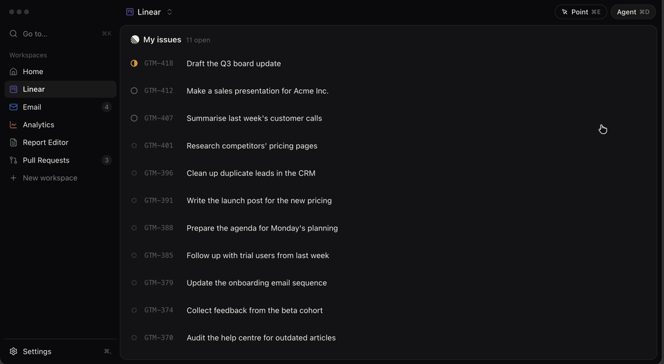
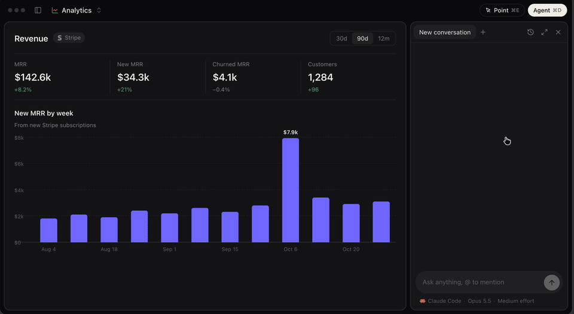
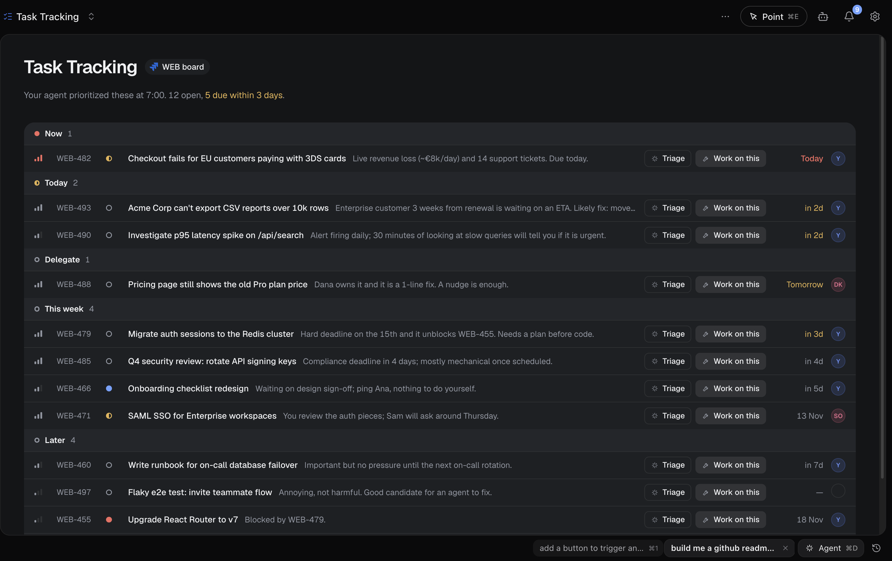
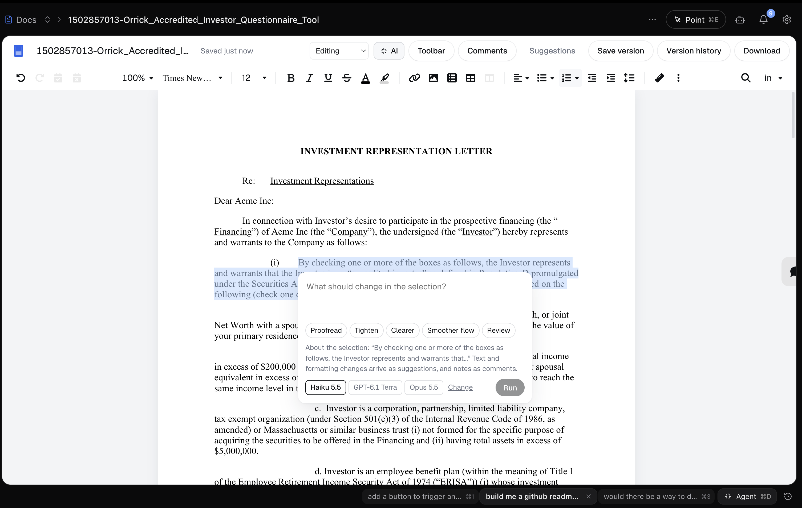
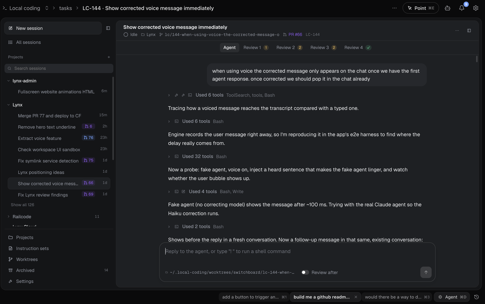
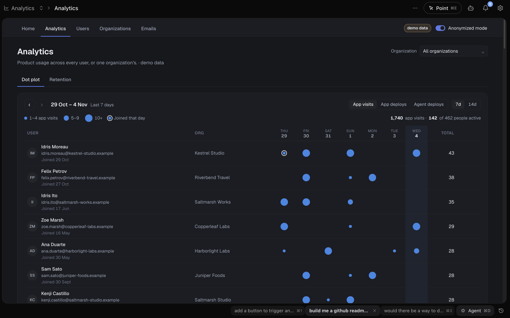
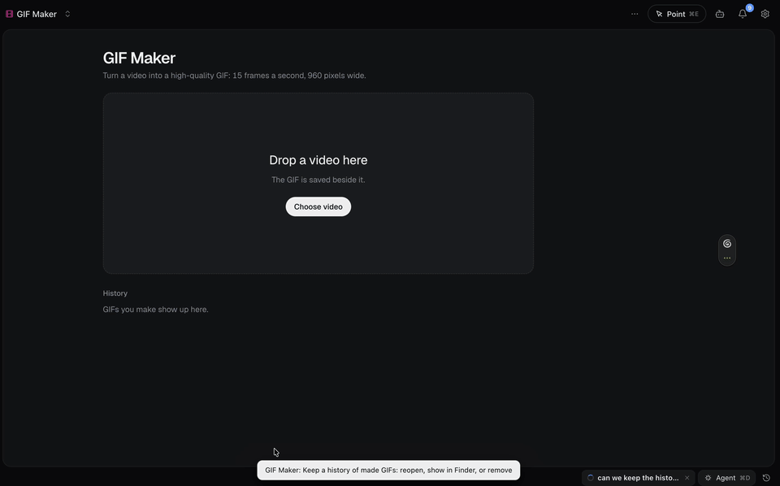
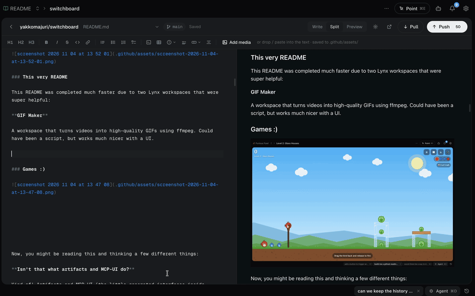
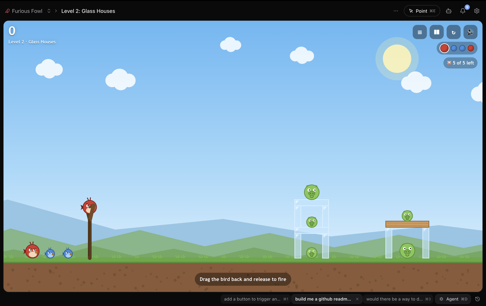

# Lynx: The open-source AI workspace you can fully customize

Lynx is a fully-customizable AI workspace designed to keep you organized and fit your work patterns. 

Most of our interactions with AI today happen through walls of text that are tiring to parse through and inefficient for working. Active AI users also quickly find themselves with more threads open than they can manage.

Lynx solves this by putting interactive interfaces at the center of our interaction with agents. Workspaces in Lynx are fully-customizable UIs, connected to the services you use, and able to trigger agents using your local Claude Code, Codex or Pi.

## Features

- **100% local**: Lynx runs on your device only and does not send data anywhere.
- **Use your own subscriptions**: Lynx makes use of Claude Code and Codex running on your machine. Switch between them as you like.
- **Connect any MCP or API**: Connect any service you use via MCP or API. You can also ask Lynx to help you connect anything else.
- **Templates**: Official and community workspace templates for you to start from and modify to your needs.
- **Fully customizable workspaces**: Create as many fully custom workspaces as you want and quickly switch between them.
- **Point to edit**: The point tool makes it easy to point out exactly what you want changed in a UI. Changes go live as soon as the agent is done editing.
- **Scheduled tasks**: Schedule tools and agents to run on a cron.

## Demo

https://github.com/user-attachments/assets/69dc02bd-20cc-4af6-ae36-477fc8f3b62f

## To-dos / task tracking example

A typical workflow for a lot of people includes waking up and asking Claude: "Check Jira for tasks assigned to me and tell me the important ones to focus on today". They then receive a bunch of text back, and go back and forth on it via chat until they've gathered the necessary context to work

With Lynx, you'd create a workspace called "Task Tracking" that connects to Jira and displays your list of tasks in a nice UI. Every morning an agent would look through these and prioritize for you, so that when you open the workspace you already have a clear overview of what's going on. Then, instead of going to a chat to ask about a specific task, you can add a button to trigger an agent to triage it, or even start working on it. To find the output of this agent you wouldn't need to search through dozens of threads, you just go to your Task Tracking workspace and see it from the UI.

## Other example workflows

Below are real examples of things people are doing with Lynx, with actual screenshots of Lynx workspaces.

### Document editing

Why reinvent something like Google Docs inside Lynx? While it's likely not relevant for most people, being able to make small tweaks to the UI and using your own AI subscription connected to your data can be really powerful. 

### Coding 

Because Lynx hooks into your coding agents and runs on your own machine, you can build your own agent orchestrator for coding the way you want it to be.

### Analytics dashboards

### This very README

This README was completed much faster due to two Lynx workspaces that were super helpful:

**GIF Maker**

A workspace that turns videos into high-quality GIFs using local `ffmpeg`. Could have been a script, but works much better with a UI.

**README Editor**

Better visual editing for GitHub READMEs with native support for media. Took 10min and one prompt:

"build me a github readme editor where I have the full markdown experience but can also put in images gifs etc and have them go to a specific dir that makes it work when I push. should be able to push directly too."

### Games :)

## License

[MIT](LICENSE).
